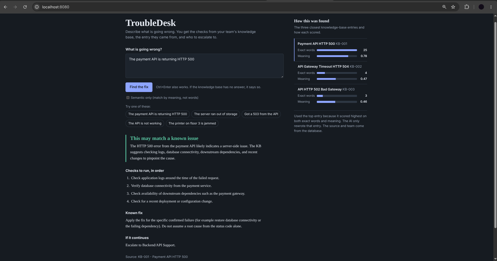

# TroubleDesk: AI Troubleshooting Assistant for L1/L2 Support

Built for Practical AI Assignment 3 (Technology Operations Intern).

You type a technical problem in plain English, for example "the payment API is returning HTTP 500".
The app searches a small knowledge base (KB), picks the most relevant entry, and asks an AI model to turn
**only that entry** into step-by-step checks. The answer also shows which KB entry it came from and which team
to escalate to. If the KB has no answer, the app says so. It does not make one up.



## The one rule behind the design

A plain AI model can sound confident and still be wrong, which is risky for troubleshooting. So the project follows one rule:

> **The knowledge base is the truth. The AI only explains it.**

The source entry, the escalation team and the known fix always come from the database (MySQL), never from the AI.
The AI only rewrites the matched entry into short, readable steps.

## What you get for each question

| Situation | What the app does | AI called? |
|---|---|---|
| A known issue matches clearly | Shows the checks, the known fix, the source entry and the escalation team | Yes |
| Something might match, but not clearly (for example "the API is not working") | Lists the possible entries and asks follow-up questions | No |
| Nothing in the KB is related (for example "the printer is jammed") | Says it is not in the knowledge base and asks for more details | No |
| The AI is down, or gives an unusable reply | Still answers, using the steps stored in the knowledge base | Tried |

Every answer also has a **"How this was found"** panel with the three closest entries and their scores, so you can check the decision.

---

## Quick start

You need **Java 21+**. Everything else is covered below.

### Step 1: Start the database

Pick **one** option.

**Option A (easiest): MySQL in a container.** Needs Podman or Docker (replace `podman` with `docker` if that's what you have).
The 24 sample entries are loaded automatically on the first start.

```bash
podman run -d --name troubleshooter-mysql -p 127.0.0.1:3306:3306 -e MYSQL_ROOT_PASSWORD=localtest \
  -v "$PWD/db/knowledge_base.sql:/docker-entrypoint-initdb.d/knowledge_base.sql:ro,Z" docker.io/library/mysql:8.4
```

Your database password is then `localtest`. To delete the container later: `podman rm -f troubleshooter-mysql`.

**Option B: MySQL already installed.** Load the 24 sample entries:

```bash
mysql -u root -p < db/knowledge_base.sql
```

### Step 2: Download the embedding model (once, about 90 MB)

```bash
mkdir -p models/all-MiniLM-L6-v2
curl -L -o models/all-MiniLM-L6-v2/model.onnx \
  https://huggingface.co/sentence-transformers/all-MiniLM-L6-v2/resolve/main/onnx/model.onnx
curl -L -o models/all-MiniLM-L6-v2/tokenizer.json \
  https://huggingface.co/sentence-transformers/all-MiniLM-L6-v2/resolve/main/tokenizer.json
```

### Step 3: Set your passwords and keys

```bash
export DB_PASSWORD='localtest'          # or your own MySQL password if you used Option B
export GROQ_API_KEY='your-groq-key'     # optional, free at console.groq.com
```

- **No Groq key?** The app still works. Answers show the steps stored in the KB instead of an AI summary.
- `DB_USER` defaults to `root`, and the database is called `ai_troubleshooter`. `GROQ_MODEL` is optional (the default is in `application.properties`).
- Never commit real keys. `.env.example` only lists the variable names.

### Step 4: Run

```bash
./mvnw spring-boot:run
```

Open **http://localhost:8080**. The first start needs internet: it downloads native libraries for the embedding
model, and it embeds the 24 entries once and saves the vectors in MySQL.

---

## Try it

### What the knowledge base knows

24 hand-written sample entries in `db/knowledge_base.sql`. Ask about anything in these lists, and something outside them to see the "I don't know" path.

| ID | Issue | ID | Issue |
|---|---|---|---|
| KB-001 | Payment API HTTP 500 | KB-009 | Database connection pool exhausted |
| KB-002 | API gateway timeout HTTP 504 | KB-010 | Deployment failed in CI/CD pipeline |
| KB-003 | API HTTP 502 Bad Gateway | KB-011 | Application OutOfMemoryError |
| KB-004 | API HTTP 503 Service Unavailable | KB-012 | Email delivery failure |
| KB-005 | HTTP 401 Unauthorized | KB-013 | SSL certificate expired |
| KB-006 | HTTP 403 Forbidden | KB-014 | Server disk space full |
| KB-007 | Database connection refused | KB-015 | SSO login failure after password reset |
| KB-008 | Slow SQL queries | | |

**Payments operations**

| ID | Issue | ID | Issue |
|---|---|---|---|
| KB-016 | UPI payment pending or failed | KB-021 | HTTP 429 Too Many Requests |
| KB-017 | Refund not credited to customer | KB-022 | Card payment declined by issuer |
| KB-018 | Merchant settlement delayed | KB-023 | Payment webhook not received |
| KB-019 | POS terminal offline | KB-024 | Reconciliation mismatch |
| KB-020 | Customer charged twice | | |

### In the browser

1. Open http://localhost:8080 and click one of the example questions, or type your own.
2. Read the answer on the left and the scores in the "How this was found" panel on the right.
3. Tick **Semantic only** and ask again to compare the two search modes.

### With curl

Run these from another terminal while the app is running. Add `| jq` at the end to pretty-print the reply, if you have `jq`.

**1. Exact match with an error code** → `ANSWERED` from KB-001, escalation team `Backend/API Support`

```bash
curl -s -X POST http://localhost:8080/api/troubleshoot \
  -H 'Content-Type: application/json' \
  -d '{"searchString": "The payment API is returning HTTP 500"}'
```

**2. Same issue in different words** → `ANSWERED` from KB-014 (Server Disk Space Full), found by meaning

```bash
curl -s -X POST http://localhost:8080/api/troubleshoot \
  -H 'Content-Type: application/json' \
  -d '{"searchString": "The server ran out of storage"}'
```

**3. The error code decides** → `ANSWERED` from KB-004 (HTTP 503), not the similar 502 entry

```bash
curl -s -X POST http://localhost:8080/api/troubleshoot \
  -H 'Content-Type: application/json' \
  -d '{"searchString": "Got a 503 from the API"}'
```

**4. Vague question** → `NEED_MORE_INFORMATION`, lists KB-001 and KB-003 as possibly related, plus 3 follow-up questions

```bash
curl -s -X POST http://localhost:8080/api/troubleshoot \
  -H 'Content-Type: application/json' \
  -d '{"searchString": "The API is not working"}'
```

**5. Not in the knowledge base** → `INSUFFICIENT_KNOWLEDGE`, and the AI is not called

```bash
curl -s -X POST http://localhost:8080/api/troubleshoot \
  -H 'Content-Type: application/json' \
  -d '{"searchString": "The printer on floor 3 is jammed"}'
```

**6. Semantic-only mode** → `ANSWERED` from KB-014. The `keywordScore` of every match is 0, because word matching is off

```bash
curl -s -X POST http://localhost:8080/api/troubleshoot \
  -H 'Content-Type: application/json' \
  -d '{"searchString": "The server ran out of storage", "semanticOnly": true}'
```

**7. Semantic-only, nothing close in meaning** → `INSUFFICIENT_KNOWLEDGE` with a "Semantic-only mode: …" summary

```bash
curl -s -X POST http://localhost:8080/api/troubleshoot \
  -H 'Content-Type: application/json' \
  -d '{"searchString": "The coffee machine is broken", "semanticOnly": true}'
```

**8. Bad input** → each one prints `400` (empty text, wrong field name, more than 1000 characters)

```bash
curl -s -o /dev/null -w '%{http_code}\n' -X POST http://localhost:8080/api/troubleshoot \
  -H 'Content-Type: application/json' -d '{"searchString": "   "}'
curl -s -o /dev/null -w '%{http_code}\n' -X POST http://localhost:8080/api/troubleshoot \
  -H 'Content-Type: application/json' -d '{"query": "wrong field name"}'
curl -s -o /dev/null -w '%{http_code}\n' -X POST http://localhost:8080/api/troubleshoot \
  -H 'Content-Type: application/json' -d "{\"searchString\": \"$(printf 'x%.0s' {1..1001})\"}"
```

Without a Groq key the statuses are the same, but an answered `summary` says "The AI summary is unavailable, …"
and the `steps` come straight from the knowledge base.

---

## How it works

```
question
   |
   |-- keyword search ----- exact words and HTTP error codes (a 503 never matches the 502 entry)
   |-- semantic search ---- meaning, using a local embedding model (all-MiniLM-L6-v2)
   |
   merge the two rankings (reciprocal rank fusion)
   |
   decide, from the raw scores:  ANSWERED  |  NEED MORE INFORMATION  |  NOT IN THE KNOWLEDGE BASE
   |
   ANSWERED only: send the top entry to the AI model (Groq) to explain it
   |
   answer = AI summary and steps  +  source, escalation team and known fix read from MySQL
```

### Key terms

- **Keyword search**: counts how many words, phrases and error codes from the question appear in each KB entry.
  Great for exact things like `502` vs `503`, but it fails when the user uses different words.
- **Embedding**: a model turns text into a list of numbers (a vector) that represents its meaning. Texts with similar
  meaning get similar vectors, so "ran out of storage" ends up close to "disk space full".
- **Cosine similarity**: a number from 0 to 1 that says how close two vectors are. Higher means closer in meaning.
- **Reciprocal rank fusion (RRF)**: keyword scores (0 to about 25) and cosine scores (0 to 1) are on different
  scales, so they can't just be added. RRF merges the two lists by *rank* instead: each list gives
  `1 / (60 + rank)` to every entry, and the points are added up.
- **Threshold**: a cut-off number that decides "good enough". The RRF score only says "better than the others",
  never "good enough", so the decision uses the raw keyword and cosine scores.

### Keyword score

| Rule | Points |
|---|---|
| HTTP error code (4xx or 5xx) found in both the question and the entry | +5 each |
| An entry keyword or phrase found in the question | +3 each |
| A question word found in the entry title | +2 each |
| A question word found in the entry symptoms (and not already in the title) | +1 each |
| The question has an error code and the entry has codes, but none match | -4 |

Entries with a score of 0 or less are dropped.

### The decision

All cut-offs live in `Thresholds.java`:

| Setting | Value | Meaning |
|---|---|---|
| `keywordMin` | 3.0 | below this, no real keyword match |
| `keywordStrong` | 8.0 | at or above this, keywords alone are enough to answer |
| `cosineLow` | 0.30 | below this, not related in meaning |
| `cosineHigh` | 0.50 | at or above this, meaning alone is enough to answer |
| `semanticOnlyMin` | 0.35 | the cut-off for semantic-only mode |

The rules, checked in this order (`OutcomePolicy.java`):

1. Keywords and meaning are both weak → **not in the knowledge base**.
2. Either one is strong → **answer**.
3. Both point to the same entry, neither is weak, and the keyword scores don't tie → **answer**.
4. Anything else (for example the keyword tie in "the API is not working") → **need more information**.

### Semantic-only mode

The **"Semantic only (match by meaning, not words)"** checkbox skips keyword matching and ranks by cosine similarity only.

- If the best cosine score is at or above `semanticOnlyMin` (0.35), the app answers from that entry. Otherwise it says
  the issue is not in the knowledge base. There is no "need more information" step in this mode.
- If the embedding model fails, it does **not** fall back to keywords, because the point of this mode is to use meaning only.
- The "Exact words" score is hidden in the side panel, because it would always be 0.

### Embeddings are made once

Each entry is turned into one text (title, symptoms and keywords) and embedded at startup. The steps are left out on purpose
because they add noise to matching. The vector is stored in MySQL with the name of the model that made it, and vectors from
different models are never compared.

---

## Code structure

Each box is one class with one job. The two interfaces (`SearchMode`, `Retriever`) are where behaviour can be swapped.

```
TroubleshootingController ──> TroubleshootingService ──> SearchMode (interface)
                                   │                       ├─ HybridSearch ──────> KeywordRetriever + SemanticRetriever
                                   │                       │                       + RankFusion + OutcomePolicy
                                   │                       └─ SemanticOnlySearch ─> SemanticRetriever + OutcomePolicy
                                   ├─> PromptBuilder ──> LlmClient (interface) ── GroqLlmClient
                                   └─> TroubleshootResponse.answered / needMoreInfo / notFound

Retriever (interface): KeywordRetriever, SemanticRetriever ──> Embedder (interface) ── LocalMiniLmEmbedder
KnowledgeEntry: label(), embeddingText(), hasEmbeddingFrom(model)
```

| Class | Job |
|---|---|
| `TroubleshootingService` | picks the search mode, asks the AI only when the match is clear, falls back to the KB steps if the AI fails |
| `HybridSearch` / `SemanticOnlySearch` | the two search modes, chosen by the checkbox |
| `KeywordRetriever` / `SemanticRetriever` | score every KB entry, by words or by meaning |
| `RankFusion` | merges the two rankings (reciprocal rank fusion) |
| `OutcomePolicy` | decides answer / need more information / not in the KB, using `Thresholds` |
| `PromptBuilder` | writes the prompts for the AI model |
| `KbIndexer` | embeds every KB entry once at startup |

Where things are:

```
db/knowledge_base.sql                         table and the 24 sample entries
src/main/java/.../model, repository           KnowledgeEntry, Status, MySQL access (KbRepository)
src/main/java/.../retrieval                   search modes, keyword and semantic retrievers, fusion, decision, KbIndexer
src/main/java/.../ai                          embedding model (local MiniLM) and Groq chat client
src/main/java/.../service                     the troubleshooting flow, prompts, reply parsing
src/main/java/.../web, dto                    POST /api/troubleshoot and the response format
src/main/resources/static/index.html          the web page
src/main/resources/application.properties     database, embedding model and Groq settings
src/test/                                     unit tests and the evaluation tests
```

## API

`POST /api/troubleshoot`

```json
{ "searchString": "The payment API is returning HTTP 500", "semanticOnly": false }
```

- `searchString` is required, 1 to 1000 characters (otherwise HTTP 400).
- `semanticOnly` is optional and defaults to `false`.

| Response field | Meaning |
|---|---|
| `status` | `ANSWERED`, `NEED_MORE_INFORMATION` or `INSUFFICIENT_KNOWLEDGE` |
| `summary` | short explanation (from the AI when answered) |
| `steps` | checks to run, in order |
| `knownResolution`, `sources`, `escalationTeam` | always read from the database |
| `followUpQuestions` | questions to add to the description when the app needs more detail |
| `matches` | the three closest entries with their keyword and cosine scores |

## Tech stack

| Part | Choice |
|---|---|
| Language | Java 21 |
| Framework | Spring Boot 4.1.2 (Jackson 3) |
| Database | MySQL 8, accessed with JdbcTemplate |
| Embeddings | `all-MiniLM-L6-v2`, run locally with Spring AI 2.0.1 (ONNX) |
| Chat model | Groq API (OpenAI-compatible), called with plain Java `HttpClient` |
| Frontend | One plain HTML/CSS/JavaScript page, no framework |
| Tests | JUnit 5 |

## Design decisions

- **Hybrid search, not only embeddings.** Embeddings understand different wording but blur exact details like 502 vs 503.
  Keywords get those right. Using both covers each method's weakness.
- **The AI is only called when the match is clear.** That makes "I don't know" a measurable rule in code, and vague or
  unrelated questions can never produce an invented answer.
- **The AI prompt is strict.** It may only use the one KB entry it is given, must say "may match" instead of claiming a
  root cause, ignores instructions hidden inside the question, and can say the entry does not fit.
- **Local embedding model.** No API quota to run out during a demo, and the KB text is not sent anywhere to be embedded.
- **Failure handling.** If the AI fails, the user still gets the KB steps. If embeddings fail at startup, the app logs a
  warning and keeps working with keyword search.

## Evaluation

37 labelled questions in `src/test/resources/eval-questions.json`: 12 in the knowledge base's own wording,
11 reworded, 4 about specific HTTP error codes, 3 vague, 7 unrelated (including tricky ones such as "my wifi is slow").

**Result at the chosen thresholds (hybrid mode): 36/37 correct, 0 false answers, 0 missed answers.**

- A *false answer* means answering with the wrong entry, or answering a vague or unrelated question. This is the dangerous error, and it never happened.
- The one miss: "Excel crashes when I open a large file" scored 0.42 in meaning against the OutOfMemoryError entry, so the
  app asked for more details instead of saying "not in the KB". It still did not give an answer, so it is a soft miss.

**Honest note:** the thresholds were tuned on the same 37 questions, so these numbers are optimistic.
They show the method works on this sample data, not how it would perform on real tickets.

**Payments entries (KB-016 to KB-024)** were added after the evaluation set was written. The 37 questions above all
still give the same results with them in the database. Each new entry was also checked with one reworded question:

| Question | Result |
|---|---|
| "Customer paid by UPI, money debited but order shows pending" | KB-016 |
| "Refund not received by customer after 7 days" | KB-017 |
| "Merchant did not get settlement yesterday" | KB-018 |
| "Card terminal at the store shows offline" | KB-019 |
| "Customer was charged twice for one order" | KB-020 |
| "Getting HTTP 429 from the payment API" | KB-021 |
| "Card payment declined with insufficient funds" | KB-022 |
| "Payment succeeded but our order is still unpaid" | KB-023 |
| "Bank report does not match our transactions" | KB-024 |

All nine were answered from the right entry. They are not yet in `eval-questions.json`.

<details>
<summary><b>Ranking quality: keyword vs semantic vs hybrid</b></summary>

For the 27 questions that have an answer in the KB: is the right entry first (top-1), or in the top 3?

| Method | Own wording | Reworded | Error codes | All (top-1) | All (top-3) |
|---|---|---|---|---|---|
| Keyword-only | 12/12 | 10/11 | 4/4 | 26/27 | 27/27 |
| Semantic-only | 12/12 | 11/11 | 4/4 | 27/27 | 27/27 |
| Hybrid (RRF) | 12/12 | 11/11 | 4/4 | 27/27 | 27/27 |

Keyword search gets one reworded question wrong. Semantic search and the hybrid get all of them right.
Keyword-only also rejected all 7 unrelated questions at threshold 3 (`KeywordEvalTest`).

</details>

<details>
<summary><b>How the hybrid thresholds were chosen</b></summary>

| Setting | Value | Why |
|---|---|---|
| `keywordMin` | 3.0 | below this a keyword match is too weak to count |
| `keywordStrong` | 8.0 | enough to answer on keywords alone. The error-code questions scored 13 to 15, well above it |
| `cosineLow` | 0.30 | below this the question is not related in meaning |
| `cosineHigh` | 0.50 | enough to answer on meaning alone |

In the `HybridEvalTest` grid, every `cosineLow` of 0.30 or 0.35 combined with a `cosineHigh` from 0.45 to 0.55 gave the
best result (36/37, no false answers, no missed answers). I kept 0.30 and 0.50 because 0.50 is in the middle of that safe
range, so a small change does not break it. Going outside the range was worse: `cosineHigh` 0.60 missed one real answer,
`cosineLow` 0.25 let more unrelated questions through (34/37), and `cosineLow` 0.45 or higher missed 3 or more real answers.
`keywordMin` and `keywordStrong` were kept fixed during the grid.

Vague questions: "The API is not working" and "Something is wrong with the server" asked for more details, and
"It does not work" said it is not in the KB. Unrelated questions: 6 of 7 said "not in the knowledge base" (printer,
laptop screen, wifi, VPN, phone reset, coffee machine).

</details>

<details>
<summary><b>How the semantic-only cut-off was chosen</b></summary>

From `SemanticEvalTest` (27 real questions and 7 unrelated ones):

| Cut-off | Real questions answered correctly (of 27) | Unrelated questions rejected (of 7) |
|---|---|---|
| 0.20 | 27 | 4 |
| 0.25 | 27 | 4 |
| 0.30 | 27 | 6 |
| **0.35** | **27** | **6** |
| 0.40 | 26 | 6 |
| 0.45 | 24 | 7 |
| 0.50 | 23 | 7 |
| 0.55 | 19 | 7 |
| 0.60 | 17 | 7 |

I chose 0.35. It answers all 27 real questions, and it sits in the gap between the weakest correct match (0.40) and the
strongest unrelated question that is still rejected (0.28). The one unrelated question that gets through is the Excel
example (0.42 against the OutOfMemoryError entry). Rejecting it needs a cut-off of 0.45, which would lose 3 of the 27 real
questions, so I accepted that trade-off.

</details>

## Tests

```bash
# Fast: no database, model or API key needed
./mvnw test -Dtest='VectorMathTest,OutcomePolicyTest,RankFusionTest,LlmReplyTest,GroqLlmClientTest'

# Everything, including the evaluation tests: needs the database (Step 1) and the model (Step 2)
DB_PASSWORD='localtest' ./mvnw test
```

The evaluation tests print the tables shown above, so you can re-check the numbers after any change.

## Limitations

- Sample data only: 24 hand-written entries, so results say little about a real knowledge base.
- The small embedding model has a narrow gap between relevant and irrelevant scores, so the thresholds are sensitive.
- In semantic-only mode there is no keyword check to catch a loose match. For example, "Excel crashes when I open a large file"
  scores 0.42 against the OutOfMemoryError entry and passes the 0.35 cut-off, so the app may answer with a related but wrong entry.
- One entry per answer: it cannot combine several symptoms into one cause.
- The AI can still be wrong or phrase things too confidently. A person must check the steps before acting.
- The free Groq tier has rate limits and may use requests to improve its models, so use sample data only.
- No login, no audit trail and no connection to live systems.

## Where this would go in production

Connect real sources (wiki, ticketing system), remove personal data before embedding, split long documents,
add a re-ranking step, restrict results by who is asking, and keep a larger set of test questions that runs on every change.

## AI usage and my own contribution

AI Usage and My Own Contribution :
I used an AI assistant (GPT) as a helper while building this project.
I wrote and own the Plan and design decisions, and I can explain every class.

### Where AI Helped
Explaining ideas I was new to : cosine similarity and rank fusion, RAG, LLM
Reviewing my code and suggesting how to split it into smaller classes and use object oriented design principles.
Helping me write and check the test setup (MySQL in a container, unit tests).

### What I Did Myself
Set up MySQL and the local embedding model (all-MiniLM-L6-v2), and ran the app on my own machine.
Wrote the knowledge-base entries (24 in total, including the 9 payments entries).
Ran the evaluation tests, read the output tables, and chose the thresholds from the results instead of guessing.
Added the semantic-only toggle across the service, controller, retrieval class, web page and tests, then checked it in the browser.
Decided the main rule of the project: the knowledge base is the truth, the AI only explains it, and "I don't know" is a rule in code, not a choice made by the AI.

### How I Handled AI in the Product Itself
The local embedding model (all-MiniLM-L6-v2) handles semantic search.
The AI model (Groq) only rewrites the one KB entry the code selected.
Source, escalation team and known fix always come from the database.
If the AI fails, the app still answers with the steps stored in the KB.
The page tells the user to check the steps before acting.

### I do not trust AI output blindly: I tested it with 37 labelled questions and checked the results myself.

